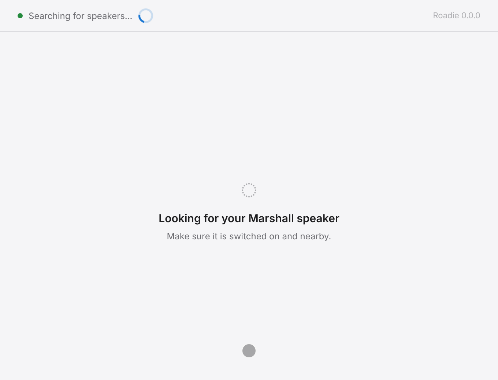
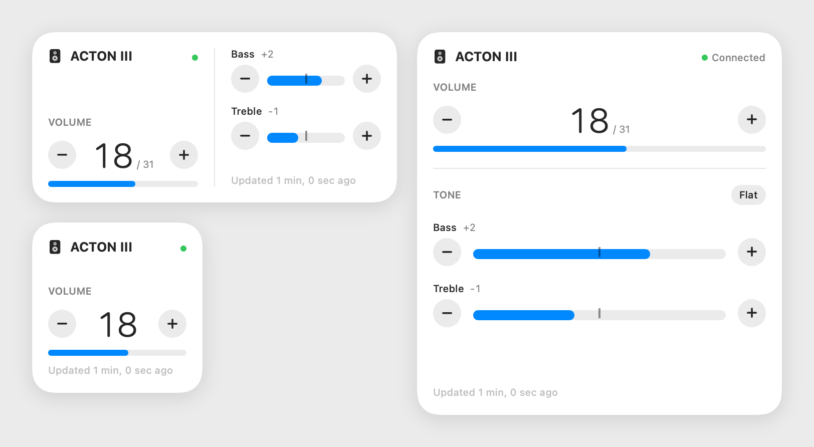

# Roadie

Volume and tone for a Marshall Bluetooth speaker, from your computer or phone:
macOS, Windows, Linux, iOS and Android, with a widget or a tray menu for
one-press changes.

<p align="center">
  
</p>

<sub>The Windows/Linux app against the demo speaker, an in-memory ACTON III
that answers with the bytes a real one sends. `make demo` records it.</sub>

## What It Does

- **Finds and connects.** Roadie searches for Marshall speakers over Bluetooth
  Low Energy, connects to the first one it finds, and shows its model,
  firmware and serial number.
- **Volume in the speaker's own steps.** 0 to the maximum the speaker reports
  (31 on an ACTON III), with no rounding through a percentage.
- **Bass and treble.** Each band runs −5 to +5 around flat, with a
  *Reset to flat* button.
- **Follows the knob.** Turn the speaker's own knob and the window moves with
  it: the speaker notifies, and Roadie shows what it stored.
- **One press from anywhere.** A desktop widget (macOS), a home screen widget
  (iOS, Android) or the tray menu (Windows, Linux) steps one control per
  press, from the value the speaker reports at that moment.
- **Updates itself** from this repository's releases, and asks before
  installing.

<p align="center">
  <picture>
    <source media="(prefers-color-scheme: dark)" srcset="docs/widgets-dark.png">
    
  </picture>
</p>

<sub>The widget in its three sizes, drawn by the widget's own views.
`make widget-snapshots` renders it.</sub>

Measured on an ACTON III (firmware 8.2.2). Other Marshall models that
advertise the same control service should work, but have not been tried.

## Platforms

| Platform | App | Bluetooth | One-press control | Updates |
|---|---|---|---|---|
| macOS 14+ | menu bar app (react-native-macos) | Swift over CoreBluetooth | WidgetKit widget, small to large | Sparkle |
| iOS 17+ | React Native | the same Swift core | the same widget; a press connects for itself | — (built in Xcode) |
| Windows | Electron + react-native-web | Web Bluetooth (WinRT) | the tray menu | electron-updater |
| Linux | Electron + react-native-web | Web Bluetooth (BlueZ) | the tray menu | electron-updater |
| Android | React Native | react-native-ble-plx | home screen widget; a press connects for itself | checks the latest release, opens the APK |

## Install

Every build is attached to the [latest release](https://github.com/leechoonguk/roadie/releases/latest).

| Platform | Download | Notes |
|---|---|---|
| macOS | `Roadie-<version>-macos.dmg` | Open it and drag Roadie to Applications. Roadie lives in the menu bar; add the widget from the desktop's *Edit Widgets*. |
| Windows | `Roadie-<version>-windows-setup.exe` | The installer is not code-signed, so SmartScreen may ask you to confirm it. |
| Linux | `Roadie-<version>-linux-x86_64.AppImage` or `…-linux-amd64.deb` | Make the AppImage executable (`chmod +x`) and run it. Needs BlueZ. |
| Android | `Roadie-<version>-android.apk` | Signed with a public debug key, not a store build: allow your browser to install apps, then open the APK. Android 12+ asks for *Nearby devices*. |
| iOS | — | Build it yourself: `make ios-pods`, open `app/ios/MarshallBluetooth.xcworkspace` in Xcode and sign with your own team. |

## How It Fits Together

One set of React Native screens runs everywhere. Under them, every platform
implements the same small API (`app/src/native/`), and there is exactly one
Bluetooth implementation per language:

```
                    app/App.tsx · app/src/screens        one set of screens
                                 │
                     app/src/native/*.ts                 the API each platform implements
                 ┌───────────────┴────────────────┐
     Swift core (macOS, iOS)            app/src/ble/client.ts (Windows, Linux, Android)
     CoreBluetooth                      Web Bluetooth · react-native-ble-plx
```

The speaker's GATT layout and the press model are written once in Swift and
once in TypeScript, and a gate holds the two halves equal. A widget or tray
press is a step (`volume +1`), never an absolute value, so it always moves
from what the speaker reports now.

| Path | What lives there |
|---|---|
| `app/src/` | screens, the shared Bluetooth client, protocol codecs, the press model |
| `app/macos/` | the macOS app, its widget and the Swift core (also compiled for iOS) |
| `app/ios/`, `app/android/` | the mobile shells |
| `app/desktop/` | the Windows/Linux Electron app |
| `app/mobile/src/` | Android's Bluetooth transport and home screen widget |
| `docs/` | the pictures in this README, made from the app |
| `.omp/` | the project's agent harness: rules, hooks and the `make verify` gate |

## Development

Everything runs through the `Makefile` in this directory; `make help` lists
every target. You need Node 22.18 or newer. The macOS and iOS apps also need
Xcode and CocoaPods; the Android APK needs the Android SDK and JDK 17.

| Need | Command |
|---|---|
| Install dependencies | `make install` (app and macOS pods), `make desktop-install`, `make ios-pods` |
| Run on macOS | `make start` in one terminal, then `make run` |
| Run on Windows or Linux | `make desktop-start` |
| Build installers | `make desktop-dist v=1.2.3` (this OS only), `make android-apk v=1.2.3`, `make ios-build` |
| Check while working | `make lint`, `make typecheck`, `make test`, `make swift-check`, `make swift-test` |
| The whole gate | `make verify` |
| Talk to a speaker without the app | `make ble-probe ARGS="--target ACTON --volume 20"` (macOS) |

### Pictures

The pictures in this README are generated, never drawn: after changing a
screen, regenerate its picture and commit it with the change.

| Picture | Command | Needs |
|---|---|---|
| `docs/demo.gif` | `make demo` | `make desktop-install` and ffmpeg; on Linux without a display, xvfb-run |
| `docs/widgets-light.png`, `docs/widgets-dark.png` | `make widget-snapshots` | macOS |

`make demo` builds the desktop app with the demo speaker in place of
Bluetooth, presses its buttons through the Chrome DevTools Protocol, records
the window and turns the frames into a GIF. The demo speaker is bundled only
for that recording; no installer carries it.

`make widget-snapshots` renders the widget's own views, light and dark, with
SwiftUI's `ImageRenderer`. CI renders them on every change to the app and
uploads them as the `widget-snapshots` artifact of the *Native* workflow, so a
machine without a Mac can take them from there.
